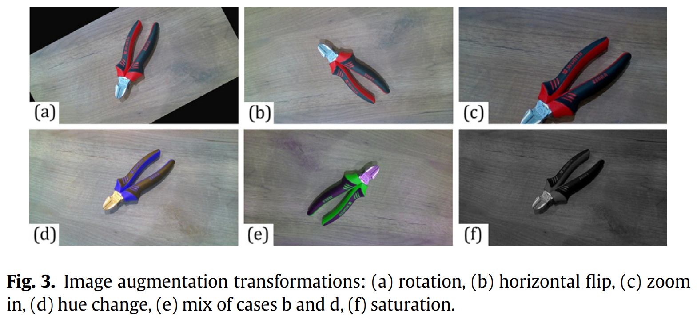
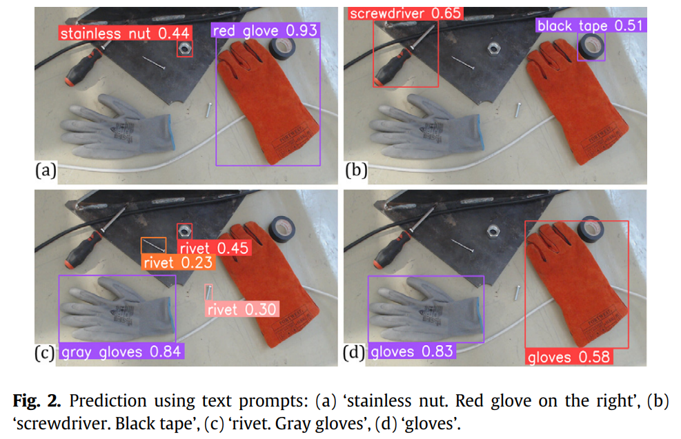
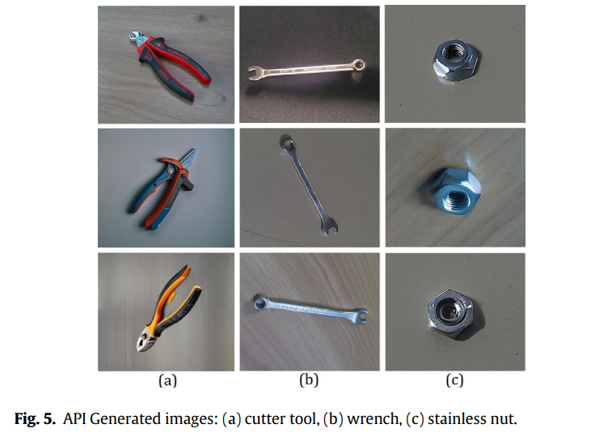

# genai-robot-perception

This is an official implementation of the paper "Aristeidou, C., Dimitropoulos, N., & Michalos, G. (2024). Generative AI and neural networks towards advanced robot cognition. *CIRP Annals, 73(1)*, 21-24."

Official link for paper: https://doi.org/10.1016/j.cirp.2024.04.013

<br>

### Acknowledgement

<p align="center">

</p>

This work has been supported by **“CONVERGING - Social industrial
collaborative environments integrating AI, Big Data and Robotics for
smart manufacturing”** project, funded by the European Commission
Horizon Europe research and innovation programme under grant
agreement No 101058521 (https://www.converging-project.eu/).

<br>
<br>
<p align="center">

</p>

<p align="center">

</p>

<p align="center">

</p>

## Setup & dependencies

1) Install Grounding DINO (https://github.com/IDEA-Research/GroundingDINO)
2) If you have available RealSense camera, install RealSense SDK (https://github.com/realsenseai/librealsense)
3) Install PyTorch (https://pytorch.org/get-started/locally/)
4) Install `requirements.txt` using `pip install -r requirements.txt`

## Repository structure

```
.
├── config.yaml              # all configurable paths and parameters
├── dataset/                 # created on the first run (images, labels, splits)
└── src
    ├── models/              # GroundingDINO config and weights, YOLO weights
    ├── master_process.py    # runs the full pipeline
    ├── image_capture.py     # camera capture
    ├── leonardo_api.py      # image generation through the Leonardo API
    ├── GDINO_inference.py   # zero-shot annotation with GroundingDINO
    ├── augmentations.py     # image/label augmentation
    ├── folder_split.py      # train/valid/test split
    ├── modify_yaml.py       # dataset yaml updating
    ├── yolo_train.py        # YOLO training
    └── utils.py             # helper functions
```

Place every model inside `src/models`:

* `GroundingDINO_SwinT_OGC.py` — copied from
  `GroundingDINO/groundingdino/config/` of the GroundingDINO repository;
* `groundingdino_swint_ogc.pth` — the GroundingDINO weights;
* `yolov8s.pt` — the YOLO starting weights.

Any other filename works as well, as long as it is written in `config.yaml`.

## Usage

Edit `config.yaml`, then run the pipeline:

```bash
python src/master_process.py                      # uses config.yaml of the repository
python src/master_process.py --config my.yaml     # uses another file
```

The pipeline can be launched from any directory: the paths of `config.yaml`
are resolved against the root of the repository, not against the current one.

The pipeline runs: capture → generation → annotation → (manual review) →
augmentation → dataset split → training.

Two things must exist before the first run:

* a Leonardo API key, either in `leonardo.api_key` or in the `LEONARDO_API_KEY`
  environment variable (`export LEONARDO_API_KEY=...`);
* the dataset descriptor pointed at by `dataset.yaml_file`, containing at least
  the `nc` and `names` keys — the pipeline appends the new class to it:

  ```yaml
  nc: 0
  names: []
  ```

## Configuration

All paths and parameters live in `config.yaml`.

* **Paths are relative to the root of the repository** (the folder holding
  `config.yaml`), whichever directory the pipeline is launched from. An
  absolute path is also accepted and is used as it is.
* **Model fields** (`grounding_dino.config_path`, `grounding_dino.weights_path`,
  `training.model_weights`) take a bare filename, which is looked up inside
  `src/models`. Writing a path with a folder in it (e.g.
  `../shared_weights/yolov8s.pt`) uses that path instead.
* **Fields left empty** fall back to the default listed below, which keeps the
  folders of the pipeline chained without repeating the same path several
  times.

### `capture` — image capture

| Parameter | Type | Default | Description |
| --- | --- | --- | --- |
| `camera` | int \| str | `0` | `"realsense"` for an Intel RealSense camera, or an integer index for a USB camera. |
| `export_path` | str | `dataset/cap_gen_augm_frames` | Folder where the captured frames are written. Created if missing. |
| `image_extension` | str | `jpg` | Extension of the captured frames (`jpg`, `png`). Also the default extension of every later step. |
| `enabled` | bool | `true` | Set to `false` to skip the capture step and reuse frames already present in `export_path`. |

During capture, press `Enter` to save the current frame and `q` to stop.

### `leonardo` — image generation

| Parameter | Type | Default | Description |
| --- | --- | --- | --- |
| `api_key` | str | `$LEONARDO_API_KEY` | Leonardo API key. Leave empty to read it from the environment variable (recommended — do not commit your key). |
| `text_prompt` | str | asked at runtime | Prompt describing the images to generate. |
| `reference_images_path` | str | `capture.export_path` | Folder with the reference images sent to the API. |
| `reference_images_extension` | str | `capture.image_extension` | Extension of the reference images. |
| `export_path` | str | `leonardo.reference_images_path` | Folder where the generated images are downloaded. |
| `images_per_batch` | int | `5` | How many reference images are submitted to the API concurrently. |
| `wait_seconds` | int | `45` | Seconds to wait for the generation jobs to finish before fetching the results. Raise it if generations come back empty. |
| `generation.model_id` | str | `1e60896f-…` | Leonardo model used for the generation. |
| `generation.width` | int | `912` | Width of the generated images, in pixels. |
| `generation.height` | int | `512` | Height of the generated images, in pixels. |
| `generation.num_images` | int | `4` | Images generated per reference image. |
| `generation.alchemy` | bool | `false` | Leonardo Alchemy pipeline (higher quality, higher cost). |
| `generation.preset_style` | str | `CINEMATIC` | Leonardo preset style. |
| `generation.init_strength` | float | `0.6` | How strongly the reference image constrains the result, `0.0`–`1.0`. |
| `enabled` | bool | `true` | Set to `false` to skip generation and annotate the captured frames only. |

### `grounding_dino` — zero-shot annotation

| Parameter | Type | Default | Description |
| --- | --- | --- | --- |
| `config_path` | str | `GroundingDINO_SwinT_OGC.py` | GroundingDINO model config (`.py`) shipped with the GroundingDINO repository, placed in `src/models`. |
| `weights_path` | str | `groundingdino_swint_ogc.pth` | GroundingDINO model weights (`.pth`), placed in `src/models`. |
| `images_path` | str | `leonardo.export_path` | Folder with the images to annotate. |
| `images_extension` | str | `capture.image_extension` | Extension of the images to annotate. |
| `text_prompt` | str | asked at runtime | Detection prompt, e.g. `"metal bracket"`. It is also used as the new class name added to the dataset yaml. |
| `box_threshold` | float | `0.35` | Minimum confidence for a box to be kept, `0.0`–`1.0`. Raise it for fewer, more certain boxes. |
| `text_threshold` | float | `0.25` | Minimum confidence for a prompt token to match a box, `0.0`–`1.0`. |
| `annotations_export_path` | str | `dataset/cap_gen_augm_labels` | Folder where the YOLO-format `.txt` annotations are written. |

### `augmentation`

| Parameter | Type | Default | Description |
| --- | --- | --- | --- |
| `images_path` | str | `grounding_dino.images_path` | Images to augment. |
| `annotations_path` | str | `grounding_dino.annotations_export_path` | Annotations of those images. |
| `multiplier_rate` | int | `3` | How many augmented copies are produced per input image. |
| `export_images_path` | str | `augmentation.images_path` | Where the augmented images are written. |
| `export_labels_path` | str | `augmentation.annotations_path` | Where the augmented labels are written. |
| `enabled` | bool | `true` | Set to `false` to skip the augmentation step. |

The transformations themselves (flips, padding, brightness/contrast, channel
shuffle, grayscale) are defined in `src/augmentations.py`.

### `dataset` — assembly and split

| Parameter | Type | Default | Description |
| --- | --- | --- | --- |
| `images_path` | str | `dataset/all_images` | Folder collecting every image (captured + generated + augmented). |
| `labels_path` | str | `dataset/all_labels` | Folder collecting every label. |
| `images_extension` | str | `capture.image_extension` | Extension of the images being split. |
| `output_folder` | str | parent of `dataset.images_path` | Root in which the `train/`, `valid/` and `test/` folders are created. |
| `split.train` | float | `0.7` | Share of the images used for training. |
| `split.valid` | float | `0.2` | Share of the images used for validation. |
| `split.test` | float | `0.1` | Share of the images used for testing. The three shares must sum to `1.0`. |
| `yaml_file` | str | `data.yaml` | Ultralytics dataset descriptor. A bare filename is resolved inside `dataset.output_folder`; a path with a separator is used as is. The file must already exist. |

### `training` — YOLO training

| Parameter | Type | Default | Description |
| --- | --- | --- | --- |
| `model_weights` | str | `yolov8s.pt` | Starting weights, or a previous run's `best.pt`. A bare filename is looked up inside `src/models`. |
| `epochs` | int | `10` | Number of training epochs. |
| `imgsz` | int | `640` | Image size the model is trained at, in pixels. |
| `batch` | int | `16` | Batch size. Lower it if you run out of GPU memory. |
| `device` | str \| int \| list | `cpu` | `"cpu"`, a GPU index (`0`), or a list of GPU indices (`[0, 1]`). |
| `lr0` | float | `0.001` | Initial learning rate. |
| `lrf` | float | `0.1` | Final learning rate factor (final lr = `lr0 * lrf`). |
| `half` | bool | `false` | Half precision (FP16). Requires a CUDA GPU. |
| `save` | bool | `true` | Save checkpoints and results of the run. |
| `enabled` | bool | `true` | Set to `false` to build the dataset but stop before training. |

### `pipeline` — pipeline behaviour

| Parameter | Type | Default | Description |
| --- | --- | --- | --- |
| `review_annotations` | bool | `true` | Pause after the GroundingDINO step so the predicted boxes can be reviewed and corrected by hand. Type `finished` to resume. |
| `step_delay` | int | `2` | Seconds the pipeline pauses between stages, so the console stays readable. |